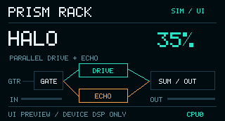

# Prism Rack 0.2.1

可切场景的模块化吉他效果架，含 Drive、Echo、Gate 和 Trim。

先安装下表的配套算法包，再安装 App。

| 文件 | 版本 |
| --- | --- |
| [App.rpk](App.rpk) | Prism Rack 0.2.1 |
| [Audio-Cell.rpk](Audio-Cell.rpk) | Prism Cell 0.1.0 |
| [Audio-Trim.rpk](Audio-Trim.rpk) | Prism Trim 0.1.0 |

[套件说明](套件说明.md) · [App 源码](source/) · [配套算法源码](source/dsp/) · [Prism Trim 源码](source/utility/) · [版本和校验值](manifest.json) · [社区发布文案](社区发布文案.md) · [开机动画预览](开机动画.gif)
