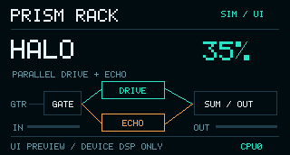

# Prism Rack

在 GLASS、EMBER 和 HALO 三个场景之间切换。想单独调 Drive 或 Echo 时，短按上方旋钮进 RACK 页。

## 配套音频包

先安装音频包，再安装 App。

- Prism Cell `org.resona.demo.prism-cell` 0.1.0
- Prism Trim `org.resona.demo.prism-trim` 0.1.0

## 两个编码器

| 页面／模式 | 上方旋转 | 上方短按 | 上方长按 | 下方旋转 | 下方短按 | 下方长按／按住 |
| --- | --- | --- | --- | --- | --- | --- |
| Prism Rack（LIVE 页） | 选 GLASS／EMBER／HALO 场景 | 切到 RACK 页 | 保存设置 | 调整体 Blend | 整架旁路开／关 | 保存设置 |
| Prism Rack（RACK 页） | 选择处理器 | 切回 LIVE 页 | 保存设置 | 选中 Cell A 时调 Drive；选中 Cell B 时调 Delay 时间；其他选中项无旋转调节 | 当前处理器开／关 | 保存设置 |

## 项目详细说明

# Prism Rack

A developer demo of the App-owned effect graph. The App builds a mono rack from five independent effects
(factory Gate and Compressor, two **Prism Cell** instances and one **Prism Trim**) and rewires it into three
scenes: GLASS, EMBER and HALO. The two user packs are the nested `dsp/` (Prism Cell) and `utility/`
(Prism Trim) projects.

## Controls

| Control | LIVE | RACK |
|---|---|---|
| SELECTOR (top) turn | scene: GLASS, EMBER, HALO | select a processor |
| SELECTOR click | next page | next page |
| CUSTOMIZE (bottom) turn | Blend, 2 % per detent | Cell A drive (2 % per detent) or Cell B delay time, when one is selected |
| CUSTOMIZE click | rack bypass on/off | selected processor on/off |
| Long press either | save settings | save settings |

Settings are saved only on a long press (or the controller's SAVE): scene, Blend, input, rack bypass, Cell A
drive, tone and level, Cell B delay time and feedback, gate threshold and input trim. Processor on/off is not
saved.

## The screen

- **LIVE**: the scene, Blend, what the scene does, any pads held on a controller, a schematic from the input
  (GTR or USB) through the gate to SUM / OUT, and input and output meters.
- **RACK**: every processor with ON/OFF and its share of the audio period as a percentage and a bar.
- **Bottom line**: the last action and its result (SETTINGS NOT SAVED on a failed write), and the audio CPU.
- **CPU LIMIT** and the processor's name when the OS bypasses one for its CPU budget; the App enables it again
  after 2 s, then 10 s, then 30 s while trips keep coming.
- **DEVICE DSP ONLY / INSTALL PRISM CELL + TRIM** until both packs are in the Box's library.
- The first 0.7 s after start is a short intro drawn by the same code as the boot splash. In Creator Lab's
  preview the App shows SIM / UI and runs no audio.

## Controller

`controller/` holds a Web controller (the Resona Box website's look) and a Mobile one (the Creator Lab app's look). Any MIDI controller can play Prism Rack too: every control is one CC on channel 1, over USB, Bluetooth or the MIDI jack. CC 119 asks the App for every value; it then reports changes, including ones made with the knobs, and the input and output meters on CC 116 and 117.

The controllers reach the scene, blend, bypass, drive and delay time, and add the input, the values the App used to fix (Cell A's tone and level, Cell B's feedback, the gate threshold, the input trim), the gate, comp and both cells on or off (not saved, as on RACK), the CPU readout, SAVE, and four hold pads played across the independent effects, with an XY surface (Blend across, Drive up). While FIRE or DUB is held, GLASS plays as EMBER so the cell is heard.

| CC | Control | Values |
|---|---|---|
| 20 | Scene | 0 GLASS, 1 EMBER, 2 HALO |
| 21 | Blend | 0 to 127: 0 to 100 % |
| 22 | Input | 0 GTR, 1 USB |
| 23 | Rack bypass | 0 off, 1 on |
| 24 | Cell A drive | 0 to 127: 0 to 100 % |
| 25 | Cell A tone | 0 to 127: 0 to 100 % (60 default) |
| 26 | Cell A level | 0 to 127: 0 to 100 % (80 default) |
| 27 | Cell B delay time | 0 to 127: 40 to 500 ms |
| 28 | Cell B feedback | 0 to 127: 0 to 70 % (25 default) |
| 29 | Gate threshold | 0 to 127: 0 to 100 % (0 default, open) |
| 30 | FIRE (hold) | 127 press, 0 release: Cell A at full drive, tone at least 90 % |
| 31 | DUB (hold) | 127 press, 0 release: Cell B feedback 68 % (EMBER's echo up from 35 to 60 %) |
| 32 | KILL (hold) | 127 press, 0 release: the input trim at 0; echoes ring on |
| 33 | DRY (hold) | 127 press, 0 release: rack bypass |
| 34 | SAVE | 127: save the App settings (a long press) |
| 40 | Input trim | 0 to 127: 0 to 100 % (80 default) |
| 41 | Gate on | 0 off, 1 on |
| 42 | Comp on | 0 off, 1 on |
| 43 | Cell A on | 0 off, 1 on |
| 44 | Cell B on | 0 off, 1 on |
| 45 | CPU (App to controller) | 0 to 127: 0 to 100 % |

## DSP: the rack

    GLASS   input -> Gate -> Trim -> out                                   clean gain
    EMBER   input -> Gate -> Trim -> Comp -> Cell A (drive) -> Cell B (echo) -> out
    HALO    input -> Gate -> Trim -> Comp -> Cell A (drive) --+-- Blend -> out
                                  \-> Cell B (echo) ----------/
    bypass  input -> out at 0.8

Mono, duplicated to both outputs. USB (when it is not the rack's input) and Bluetooth pass straight to the
output. Blend only acts in HALO. Bypassed or disconnected processors keep their CPU and memory reservations.

**Prism Cell** (`dsp/`): MODE 0 passes the signal, 1 is a soft drive into a one-pole tone filter, 2 is an echo
on a 128 KiB PSRAM line. **Prism Trim** (`utility/`): one GAIN.

| Effect | Parameter | Range | Set by the App |
|---|---|---|---|
| Gate (factory) | threshold | 0 to 100 % | 0, or controller CC 29 |
| Trim | GAIN | 0 to 1 | 0.8, or controller CC 40; KILL sets 0 |
| Comp (factory) | | | factory defaults |
| Cell A | MODE | 0 to 2 | 1 (drive) |
| Cell A | DRIVE | 0 to 1 | RACK turn, controller CC 24 (default 25 %); FIRE sets 1 |
| Cell A | TONE | 0 to 1 | 0.6, or controller CC 25; FIRE raises it to at least 0.9 |
| Cell A | LEVEL | 0 to 1 | 0.8, or controller CC 26 |
| Cell B | MODE | 0 to 2 | 2 (echo) |
| Cell B | TIME | 40 to 500 ms | RACK turn, controller CC 27 (default 180 ms) |
| Cell B | FEEDBACK | 0 to 0.7 | 0.25, or controller CC 28; DUB sets 0.68 |
| Cell B | WET | 0 to 1 | 0.35 in EMBER (0.6 with DUB), 1 in HALO |
| Cell B | LEVEL | 0 to 1 | 1 |

## Build

Review the source, then trust the three folders and build:

    resona-lab trust allow . --acknowledge-native-code
    resona-lab trust allow dsp --acknowledge-native-code
    resona-lab trust allow utility --acknowledge-native-code
    resona-lab check dsp
    resona-lab check utility
    resona-lab pack build dsp
    resona-lab pack build utility
    resona-lab pack install dsp/build/*.rpk        # store both packs in the Box's library first
    resona-lab pack install utility/build/*.rpk
    resona-lab app build .
    resona-lab app install .

Preset loads and edits are refused while this App owns audio; return to the Factory App before updating the
packs, then reinstall.

The boot splash is `assets/prism.rsp` (4 frames, 1600 ms). To change it, edit `gfx::splash` in `src/gfx.hpp`
and run `tools/make_assets.cpp` on the host from the App folder; it rewrites `assets/prism.rsp`,
`assets/splash-*.ppm` and `src/generated/splash_data.h`:

    c++ -std=c++17 -O2 -I /path/to/pinned-sdk/include tools/make_assets.cpp -o make_assets && ./make_assets
    resona-lab startup install-splash assets/prism.rsp    # restore-splash returns the factory one

Bench builds (`-DRESONA_DEMO_BENCH`) add an SDK LAB page (adding and removing extra Trim instances until the
CPU budget refuses one, heap, timer, cycle, storage and splash probes, reboot through the SDK), the channel-16
control and reply CCs, and screen capture. The Python scripts in `tools/` drive those bench builds.

MIT, see LICENSE.

## 开机动画

青绿色棱镜主题动画在通电时播放。 首次运行时保存到 Resona Box，下次开机播放。
